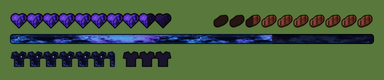

# Galaxy GUI — Minecraft 1.8.9 resource pack



A HUD pack for **Minecraft 1.8.9** with:

- **Animated galaxy hearts**: smooth, high-resolution hearts filled with a realistic deep-space starfield (dark indigo, purple nebula clouds, twinkling stars) that slowly drifts. Hardcore hearts animate too.
- **Steak hunger bar**: cartoon HD steaks shaped like the Minecraft steak, with black grill burn lines, replace the drumsticks. There are also matching "hunger effect" (green) and flashing variants.
- **Animated galaxy XP bar**: the same starfield style shifted to blue/cyan, with nebula clouds that flow along the bar.
- Matching smooth galaxy armor, plus air bubbles, boss bar, horse-jump bar, tab-list ping icons and crosshair.

It comes in two resolutions:

| File | Resolution |
| --- | --- |
| [`dist/Galaxy-GUI-256x-1.8.9.zip`](dist/Galaxy-GUI-256x-1.8.9.zip) | 256x |
| [`dist/Galaxy-GUI-512x-1.8.9.zip`](dist/Galaxy-GUI-512x-1.8.9.zip) | 512x |

## Install

1. Download one of the zips above. Don't unzip it.
2. Put it in `.minecraft/resourcepacks/`.
3. In game, go to **Options → Resource Packs** and enable **Galaxy GUI**.

### You need OptiFine for the animation

Vanilla 1.8.9 can't animate GUI textures, so the moving hearts and XP bar use OptiFine's
*Custom Animations* (`assets/minecraft/mcpatcher/anim/`).

- Install **OptiFine 1.8.9** and make sure **Video Settings → Quality → Custom Animations** is **ON**.
  This also works in clients that bundle OptiFine.
- Without OptiFine, the pack still works but the hearts and XP bar show a single still galaxy frame.

The 512x pack uses an 8192×8192 `icons.png`, which needs a GPU that supports 8K textures (almost all do).
If the HUD looks blank or broken, use the 256x version.

## Building / editing

Everything is drawn procedurally by [`generator/build.py`](generator/build.py). The textures are original and no Mojang art is included.

```bash
pip install numpy pillow
python3 generator/build.py --preview          # builds both zips into dist/ + previews/
python3 generator/build.py --res 256          # just one size
```

Colours live in the `PAL_*` palettes near the top of the script. Animation speed is set by
`HEART_FRAMES` / `XP_FRAMES` and `*_DURATION` (in ticks per frame).

### Steak designs

There are 4 steak designs to choose from (see [`previews/steak-variants.png`](previews/steak-variants.png)):

- `char-cross` (default): blackened crust, crosshatch grill and glowing embers
- `tapered`: deep red BBQ glaze with wet highlights and thick burns
- `bitten`: golden grilled steak with a bite showing the pink inside
- `flat-toon`: flat, bright cartoon style with bold burns

```bash
python3 generator/build.py --steak flat-toon
```
